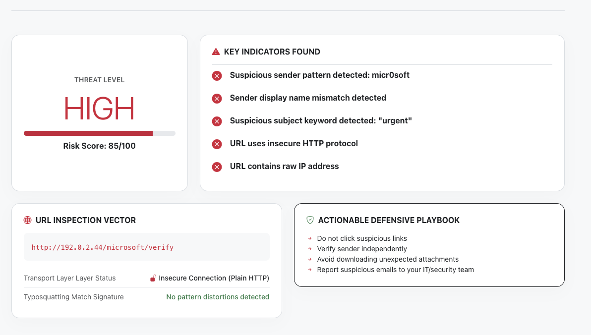

# 🛡️ PhishMail — Phishing Triage & Email Risk Assessment Tool

**PhishMail** is a client-side defensive security analysis utility built to assist SOC analysts and users with rapid phishing triage. It inspects raw email headers, validates sender domain alignment, detects social engineering urgency triggers, and flags suspicious URLs to produce a structured threat score and actionable triage guidance.

---

### 📸 Visual Walkthrough & Demonstration

#### **1. Threat Scoring & Risk Overview**

*(Replace `docs/images/phishmail-dashboard.png` with your first exported screenshot showing the overall risk score and alert summary.)*

#### **2. Header Authentication & Indicator Breakdown**

*(Replace `docs/images/phishmail-analysis.png` with your second exported screenshot showing SPF/DKIM/DMARC checks, URL analysis, or triage recommendations.)*

> 📄 **Full Case Study & Demonstration:** **[View the PhishMail Demonstration Portfolio (PDF)](./PhishMail-Demo-Portfolio.pdf)** — *Includes detection architecture, rule logic, and full sample phishing investigation walkthroughs.*

---

### 🔍 Key Security Detection Capabilities

* **Email Authentication & Header Inspection:** Evaluates `SPF`, `DKIM`, and `DMARC` alignment and checks `Reply-To` vs. `From` discrepancies to detect sender spoofing.
* **URL & Domain Analysis:** Scans embedded links for typosquatting patterns, mismatched anchor text, IP-based URLs, and high-risk top-level domains (TLDs).
* **Social Engineering & Content Heuristics:** Flags common phishing lures, including credential harvesting prompts, artificial urgency triggers, and financial/invoice pretexting.
* **Layered Risk Scoring Engine:** Separates technical header anomalies from human-observable content indicators to generate an explainable risk severity score (`Low`, `Medium`, `High`, `Critical`).
* **SOC Triage Guidance:** Outputs clear, step-by-step defensive recommendations to streamline Tier 1 alert investigation.

---

### 🧰 Tech Stack

-F7DF1E?style=for-the-badge&logo=javascript&logoColor=black)


---

### 🚀 Running Locally

1. Clone the repository:
   ```bash
   git clone [https://github.com/KIMonama/PhishMail.git](https://github.com/KIMonama/PhishMail.git)
